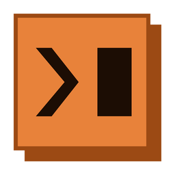
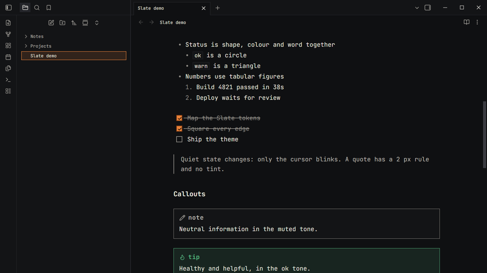
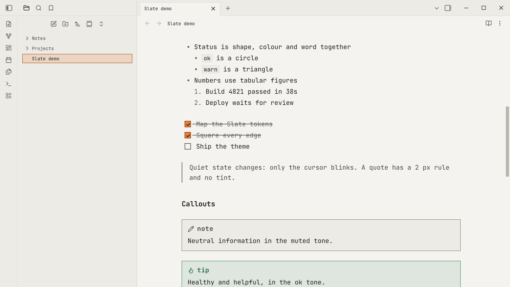
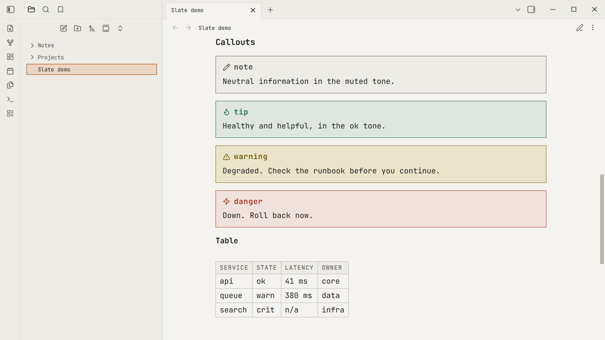
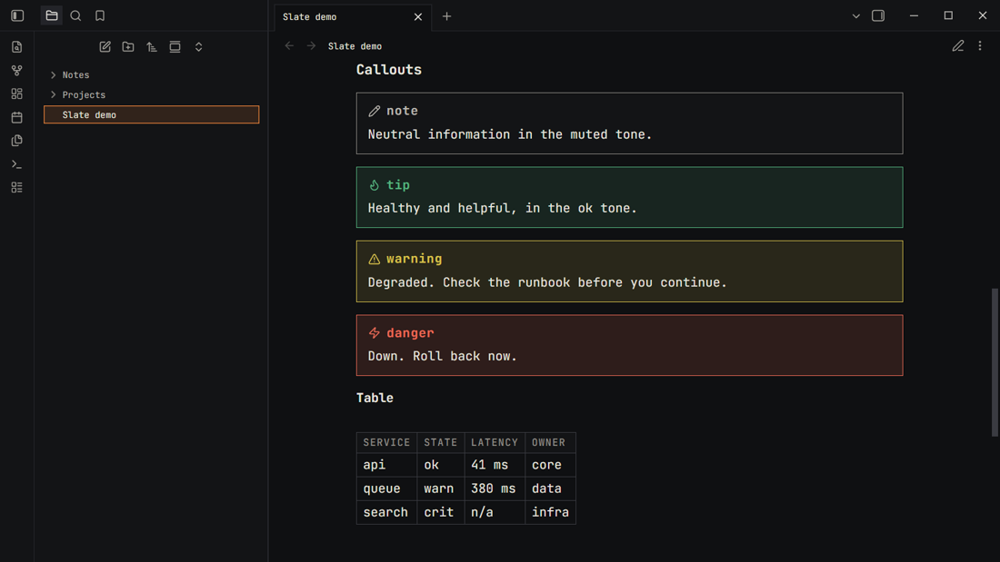
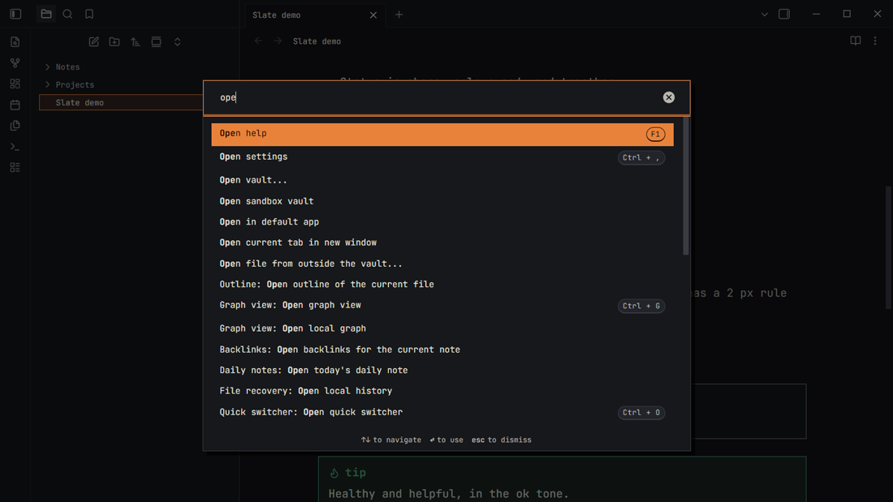

<p align="center"></p>

<h1 align="center">Slate</h1>

<p align="center">
	A dense, calm, keyboard-first theme for <a href="https://obsidian.md">Obsidian</a>.<br>
	One monospace typeface, square edges, hard offset shadows and a single ember accent.
</p>

<p align="center">
	<a href="https://github.com/CodingJinxx/obsidian-slate-theme/actions/workflows/ci.yml"></a>
	<a href="https://github.com/CodingJinxx/obsidian-slate-theme/releases/latest"></a>
	<a href="LICENSE"></a>
</p>

<p align="center"></p>

Slate is the Obsidian version of the **Slate design system**: the same tokens (colours, type, spacing, shadows), applied to Obsidian's own variables so core UI, notes and most plugins follow them. It has a light and a dark variant and follows Obsidian's *Appearance → Base color scheme* setting.

## Install

**From the community list** (once it is accepted): *Settings → Appearance → Themes → Manage*, search for **Slate**, then *Install and use*.

**Today, with BRAT:** install the [BRAT](https://github.com/TfTHacker/obsidian42-brat) plugin, run *BRAT: Add a beta theme for testing*, and enter `CodingJinxx/obsidian-slate-theme`.

**By hand:** download `theme.css` and `manifest.json` from the [latest release](https://github.com/CodingJinxx/obsidian-slate-theme/releases/latest) into a folder named `Slate` inside `<your vault>/.obsidian/themes/`, then pick *Slate* under *Settings → Appearance → Themes*.

Nothing is loaded from the network: the font is embedded in `theme.css` as a Latin subset (`scripts/subset-fonts.py`).

## What it looks like

| | Light | Dark |
| --- | --- | --- |
| Live Preview |  |  |
| Reading view |  |  |

<p align="center"></p>

## The design

- **Type.** JetBrains Mono, ligatures off, tabular figures in tables and counters. Weight, case and tracking do the work: table headers are small caps, tags and callout titles are lower case.
- **Colour.** Warm greys, text at 4.5:1 or more in both variants. **Ember** (`#e8823a`) is the one brand colour. It fills the call to action and the chosen row, and is never used as text: links use a darker ember (`accent-text`) that keeps its contrast.
- **Status is shape, colour and word.** Callouts take the Slate status tones: *ok* (tip, success), *warn* (warning, question), *crit* (danger, failure, bug), *agent* (example, abstract) and neutral for the rest.
- **Edges.** Radius is 0 everywhere. Buttons and the command palette use hard offset shadows with no blur; the primary button sinks 2 px when pressed.
- **Focus.** A 2 px solid ring, offset by 1 px, for keyboard users.
- **Motion.** No added animation, and transitions are switched off under *reduce motion*.

The tokens live in [`src/01-tokens.css`](src/01-tokens.css) under the `--sl-` prefix, and [`src/02-variables.css`](src/02-variables.css) maps them onto Obsidian's variables, so you can retune the theme from your own CSS snippet:

```css
/* .obsidian/snippets/slate-tweaks.css */
body {
	--font-text-size: 15px;
}
.theme-dark {
	--sl-color-accent: #4aa3ff; /* a different accent, dark mode only */
}
```

## Compatibility

Tested in a real Obsidian on **1.8.10** and the **latest** release (1.14), light and dark, desktop. `manifest.json` asks for 1.8.10 or newer. Plugins that draw their own UI usually pick the colours up through Obsidian's variables; if one does not, open an issue with a screenshot.

## Development

```sh
npm install
npm run build        # builds theme.css from src/*.css and fonts/
npm run check        # theme.css is up to date; manifest and CSS rules
npm run screenshots  # drives a real Obsidian and writes test/screenshots/*.png
```

`theme.css` is generated: edit the files in `src/`, run `npm run build` and commit both. See [CONTRIBUTING.md](CONTRIBUTING.md).

## Support

Slate is free and open source. If you like it, you can [buy me a coffee](https://buymeacoffee.com/codingjinxx).

## Credits and licence

- The Slate design system's tokens and look.
- [JetBrains Mono](https://github.com/JetBrains/JetBrainsMono), © The JetBrains Mono Project Authors, under the [SIL Open Font License 1.1](fonts/OFL.txt), embedded in `theme.css` as a Latin subset (`scripts/subset-fonts.py`).
- Everything else: © Jay Leimer, under the [PolyForm Noncommercial License 1.0.0](LICENSE). In short: free to use, copy and change for personal and other non-commercial purposes; commercial use, including selling the theme or bundling it in a paid product, needs the author's permission. This is source-available, not open source. JetBrains Mono keeps its own free licence (above).
